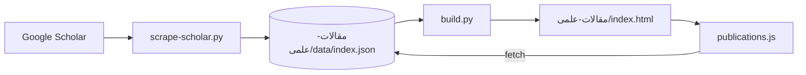

# سیستم مقالات علمی – drnaderakbari.com

این سند پیاده‌سازی فعلی مخزن `dr-nader-akbari-website` و صفحهٔ `https://drnaderakbari.com/مقالات-علمی/` را توضیح می‌دهد (بر پایهٔ الگوی givsharifi.com، با UI فارسی و RTL).

---

## 1. خلاصه

| مورد | مقدار |
|------|--------|
| صفحه | `/مقالات-علمی/` |
| Scholar | `user=13wD0fwAAAAJ` |
| داده | `مقالات-علمی/data/index.json` (~۹۹ مقاله، اکتبر ۲۰۲۶) |
| UI | فارسی (جستجو، فیلتر، متریک‌ها) |
| متاداده مقاله | انگلیسی (عنوان، نویسندگان، ژورنال) |

**ویژگی‌ها:** متریک‌های total / citations / h-index / i10، جستجوی کلاینت، فیلتر سال و موضوع (فارسی)، مرتب‌سازی «جدیدترین اول» (پیش‌فرض) و «بیشترین استناد»، کارت با لینک به `view_citation` در Scholar، اسکلتون لودینگ، JSON-LD `ItemList` (۵۰ مقاله اول).

---

## 2. داده و به‌روزرسانی

```
Google Scholar HTML  →  scripts/scrape-scholar.py  →  مقالات-علمی/data/index.json
مرورگر               →  GET /مقالات-علمی/data/index.json
```

**اجرای دستی (از ریشهٔ پروژه):**

```bash
python scripts/scrape-scholar.py
python _build/build.py
```

- `SCHOLAR_USER = "13wD0fwAAAAJ"` در اسکریپت.
- صفحه‌بندی: `cstart` ۰، ۱۰۰، …؛ تأخیر ۲.۵ ثانیه بین صفحات.
- `topic` با regex روی title+journal (برچسب‌های فارسی ENT؛ پیش‌فرض «تحقیقاتی»).
- در صورت CAPTCHA اسکریپت خطای صریح می‌دهد؛ scrape را محلی تکرار کنید.

**فرمت JSON** (مثل givsharifi): `updated`, `stats`, `publications[]` با فیلدهای `id`, `title`, `authors`, `journal`, `year`, `citations`, `topic`, `url`.

`build.py` فقط `مقالات-علمی/index.html` را تولید می‌کند؛ پوشهٔ `data/` overwrite نمی‌شود.

---

## 3. فرانت‌اند

| فایل | نقش |
|------|-----|
| `_build/templates/publications.html` | قالب HTML صفحه |
| `js/publications.js` | fetch، فیلتر، رندر کارت، schema |
| `css/styles.css` | بلوک `.pub-*` (RTL؛ متن مقاله `dir="ltr"`) |
| `_build/build.py` → `render_publications()` | SEO، breadcrumb، ProfilePage |

**منو:** لینک «مقالات علمی» بعد از «بلاگ» در `build_nav()`.

**صفحهٔ اصلی:** `patch_homepage_publications()` — `data-count` از `stats.total`، لینک به `/مقالات-علمی/`، `sameAs` Scholar در JSON-LD پزشک.

---

## 4. SEO

- canonical و Open Graph در خروجی build.
- `ProfilePage` + `Physician.sameAs` → Scholar.
- `ItemList` پس از لود JS (حداکثر ۵۰ مقاله).
- مسیر در `sitemap.xml` با `priority` ۰.۷۵ و `lastmod` از `updated`.

---

## 5. چک‌لیست نگهداری

- [ ] پس از scrape: `build.py` و commit JSON
- [ ] `stats.total` با `len(publications)` هم‌خوان
- [ ] عنوان/نویسندگان/ژورنال در UI ترجمه نشوند
- [ ] لینک کارت‌ها `rel="noopener noreferrer"`
- [ ] در صورت تغییر منو، یک بار `build.py` برای sync `index.html` / مقالات

---

## 6. محدودیت‌ها

- داده تا آخرین scrape به‌روز است (نه زنده از Scholar).
- scrape به HTML Scholar وابسته است.
- همه کارت‌ها یک‌جا در DOM (بدون pagination).
- `topic` استنتاجی است؛ برای کیفیت فیلتر می‌توان در JSON دستی اصلاح کرد.

---

## نقشهٔ وابستگی


